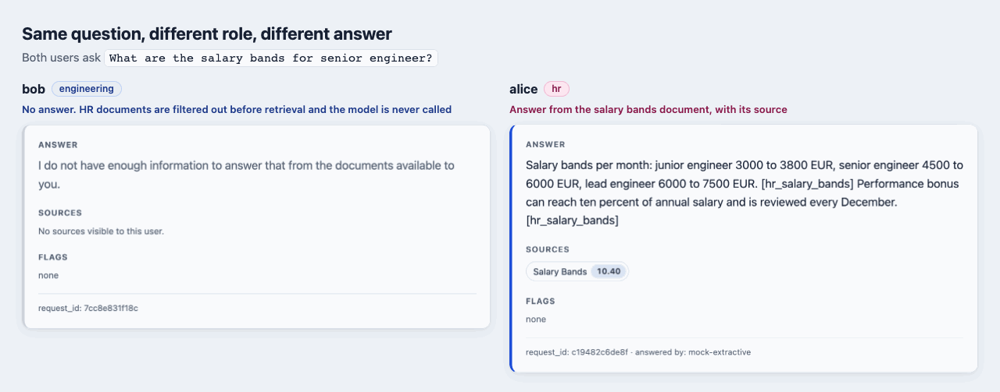
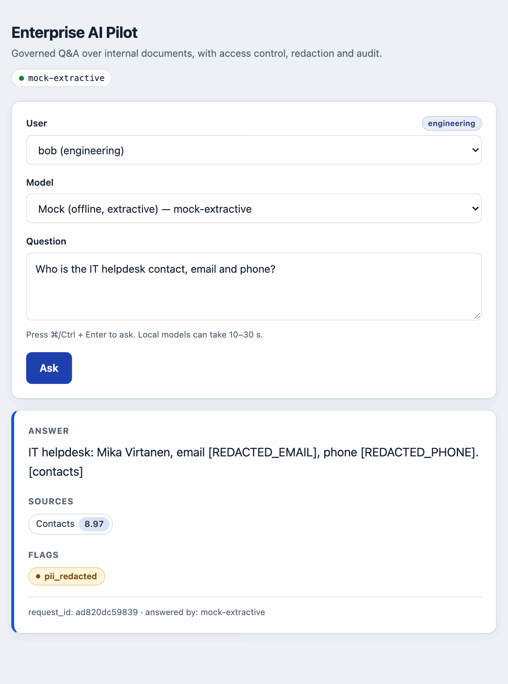

# Enterprise AI Pilot



A small, runnable, source-available reference for taking an internal-knowledge AI assistant from
"works in a demo" to "something an enterprise security team can say yes to".
It answers questions over company documents and shows the governance layer
that usually decides whether a pilot reaches production.

> [!WARNING]
> **Do not expose this demo to the internet. Demo API keys are fake and public.**
> The identities below are hard-coded and shown in the web UI. Run it on `127.0.0.1` only.

## Run it

```bash
pip install -r requirements.txt
uvicorn app.main:app --host 127.0.0.1 --port 8000
open http://127.0.0.1:8000/          # web UI: pick a user and model, ask, see sources + flags
curl -s 127.0.0.1:8000/ask -H 'X-API-Key: key-bob' -H 'Content-Type: application/json' \
  -d '{"question":"How many vacation days do employees get?"}'
```

With no configuration it runs fully offline on the built-in extractive mock model.

Demo identities: `key-alice` (HR), `key-bob` (engineering), `key-carol` (finance), `key-dave` (admin).
Try asking for salary bands as bob, then as alice.

```bash
python -m pytest -q        # 66 tests, no network
python -m eval.run_eval    # groundedness / leakage / refusal / citation / safety gates (exit 1 on failure)
```

## Real models (optional)

Mock is the default. A real provider is only enabled when its environment variables are set.

```bash
cp .env.example .env                                      # .env is git-ignored; fill in locally
uvicorn app.main:app --host 127.0.0.1 --env-file .env
```

- **Claude:** set `ANTHROPIC_API_KEY` (optional `CLAUDE_MODEL`, default `claude-opus-5-5`). Uses the
  official `anthropic` SDK with the shared system prompt, `max_tokens=400`, a 15 s timeout and no SDK
  retries. `temperature=0.1` is sent to models that accept it; current models reject sampling
  params, so they get `effort=low` instead.
- **Ollama (fully local, no key):** `ollama pull llama3.2`, then set `OLLAMA_URL=http://localhost:11434`
  and `OLLAMA_MODEL=llama3.2` (or run with `LLM_PROVIDER=ollama`). Calls `POST {OLLAMA_URL}/api/chat`
  with `stream=false`, `temperature=0.1` and a 30 s timeout. On slow hardware (e.g. a small
  single-board computer on CPU) raise `OLLAMA_TIMEOUT` and cap output with `OLLAMA_NUM_PREDICT`,
  e.g. `90` and `200`.
- **Gemini:** set `GEMINI_API_KEY` (optional `GEMINI_MODEL`).

Any provider error (timeout, auth, model not pulled, server down) degrades to the extractive
answer and is flagged `llm_fallback:<Error>`; the request still succeeds.
Tests never load `.env` and never call the network.

### Choosing the model per request

Every configured provider is listed by `GET /providers` and can be picked in the web UI's
**Model** dropdown (or with `"provider": "<id>"` in the `/ask` body). Mock is always available;
`LLM_PROVIDER` sets the default. Unknown ids are rejected (400, audited), the ACL filter runs
before any provider sees context, and the response and audit record name the model that
actually answered.

| id | enabled when | notes |
|---|---|---|
| `mock` | always | offline extractive answerer |
| `claude` | `ANTHROPIC_API_KEY` set | `CLAUDE_MODEL` |
| `ollama` | `OLLAMA_URL` set or `LLM_PROVIDER=ollama` | `OLLAMA_MODEL`, `OLLAMA_TIMEOUT`, `OLLAMA_NUM_PREDICT` |
| `ollama-remote` | `OLLAMA_REMOTE_URL` set | same `OLLAMA_REMOTE_*` knobs |
| `gemini` | `GEMINI_API_KEY` set | `GEMINI_MODEL` |

Keep a remote Ollama bound to its own `127.0.0.1` and reach it with an SSH tunnel instead of
exposing it on the network:
`ssh -N -L 11435:localhost:11434 <user>@<remote-host>` then `OLLAMA_REMOTE_URL=http://localhost:11435`.

## Demo video

`python demo/record_demo.py` records a ~30 s walkthrough (role-based access, PII redaction,
sources and flags) to `demo/demo.webm` / `demo/demo.mp4`, and `python demo/take_screenshots.py`
regenerates the images in `docs/images/`. Both always run the mock model with a scrubbed
environment. Recordings are not committed; see [demo/README.md](demo/README.md).

## Architecture


The model is one box in the middle. Everything around it is plain code that decides what the
model may see and what the user may get back:

```
authn -> rate limit -> injection check (query) -> ACL-filtered retrieval -> relevance gate
      -> drop poisoned chunks -> no context? refuse (LLM never called)
      -> LLM (fallback on failure) -> citation validation
      -> output PII redaction -> hash-chained audit record
```

Retrieval applies the role filter first, then a relevance gate: a chunk is kept only if it
matches at least two distinct question terms (or half of a short question), clears a small
BM25 minimum, and does not match on generic words like "engineer" alone. If nothing survives,
the request is refused without calling the model. Thresholds live at the top of
`app/retrieval.py`.

<p align="center">
  
</p>

## Governance decisions (and why)

| Concern | What the pilot does | Production upgrade |
|---|---|---|
| Access control | Filter by role **before** retrieval, so forbidden text never reaches the prompt | SSO/OIDC, group-to-role mapping, per-document ACL sync |
| Data leakage | PII (email, phone, IBAN, Finnish HETU) redacted in answers and never written to logs | Dedicated DLP service, EU data residency for the model endpoint |
| Prompt injection | Heuristics on the query and on retrieved chunks; model told context is data | Classifier-based guard, tool/permission isolation |
| Hallucination | Relevance gate drops off-topic chunks; refuses without context; citations must match the chunks the model was given, uncited answers flagged `no_citation` | Faithfulness evals on a larger labelled set |
| Auditability | Append-only JSONL, each record hashes the previous one; `/audit/verify` | Ship to SIEM, WORM storage |
| Vendor lock-in | `LLM` interface; mock, Gemini, Claude, local Ollama; swap in Azure OpenAI | Routing by cost, latency, data class |
| Reliability | Provider failure degrades to extractive answer, request still succeeds | Circuit breaker, retries with jitter |
| Regression | Eval gates run in CI: zero leaks, full groundedness, unanswerable questions refused | Larger eval set, red-team prompts |

## Honest limits

- Retrieval is BM25 with a lexical relevance gate for clarity; real deployments add embeddings,
  a reranker and a tuned score threshold.
- Injection and PII detection are heuristic, which is why they are layered with ACLs, refusal and audit.
- Citation validation checks source IDs, not meaning. It normalises `[doc_id: x]`, `[doc: x]`,
  `[source: x]` and several ids in one bracket to `[x]`, strips any id the model was not given
  (`ungrounded_citation_removed`), and flags answers with no valid citation (`no_citation`)
  without blocking them. It does not verify that the cited chunk actually supports the claim;
  quote matching or an entailment check would be the next layer. Citations are per document,
  not per chunk.
- Demo API keys live in code and in the web UI. They are fake and public; never reuse them.
  Real provider keys only go in your local `.env`.
- **Rate limiting is in-memory and per process.** Each uvicorn worker or replica keeps its own
  counters and they reset on restart; use a shared store (e.g. Redis) when scaling out.
- The sample corpus is fictional: names, the `.example` email domain, phone number, IBAN and
  identity code are made-up test data.

## Layout

```
app/        main.py (pipeline) retrieval.py security.py audit.py llm.py
app/static/ index.html single-page UI served at "/" (plain JS, uses /providers, /ask, /audit/verify)
data/docs/  sample corpus with per-document access roles
tests/      behaviour tests incl. ACL, redaction, injection, tamper detection, providers (mocked), UI route
eval/       run_eval.py offline quality and safety gates
demo/       record_demo.py and take_screenshots.py (Playwright, mock mode)
docs/images README screenshots and architecture diagram
```

## License

Source-available under the [PolyForm Noncommercial License 1.0.0](LICENSE): free for
noncommercial use; commercial use needs permission from the author. This is not an OSI
"open source" license.
